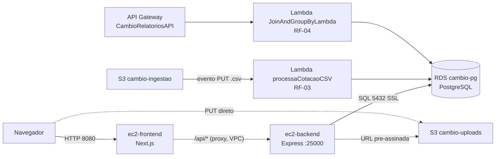

# Infraestrutura criada pelo Console AWS (sem IaC)

> **RNF-05:** nenhum recurso deste projeto é criado por IaC (CloudFormation, CDK,
> Terraform, SAM). Tudo foi criado manualmente pelo **Console AWS** do Learner Lab,
> na região **us-east-1**, e está documentado aqui na ordem em que deve ser criado.
> Sempre que um passo pede "anote", o valor será usado em um `.env` mais adiante.

## Visão geral



| Recurso | Nome | Observação |
|---|---|---|
| VPC | `projeto-vpc` | 10.0.0.0/16 |
| Sub-rede pública | `projeto-subnet-publica` | 10.0.1.0/24, us-east-1a, EC2s |
| Sub-redes privadas | `priv-a`, `priv-b` | 10.0.2.0/24 e 10.0.3.0/24, RDS e Lambdas |
| Endpoint S3 (Gateway) | `vpce-...` | Lambdas nas sub-redes privadas alcançam o S3 |
| EC2 back-end | `ec2-backend` | Docker, Express :25000, Elastic IP |
| EC2 front-end | `ec2-frontend` | Docker, Next.js :8080 |
| RDS | `cambio-pg` | PostgreSQL, banco `postgres` (schema `public`), sem acesso público |
| Buckets | `cambio-uploads-<seunome>`, `cambio-ingestao-<seunome>` | RF-02 e RF-03 |
| Lambdas | `processaCotacaoCSV`, `JoinAndGroupByLambda` | RF-03 e RF-04 |
| API Gateway | `CambioRelatoriosAPI` | REST, stage `prod` |

## Passo 1. Rede (VPC > Your VPCs > Create VPC)

1. **VPC and more**: nome `projeto`, IPv4 `10.0.0.0/16`, 1 AZ pública (us-east-1a) e
   2 sub-redes privadas em AZs diferentes (us-east-1a e us-east-1b, exigência do RDS).
2. NAT gateway: **None**. VPC endpoints: **S3 Gateway** (marque as route tables privadas).
3. Confirme: a sub-rede pública tem rota `0.0.0.0/0 -> Internet Gateway` e
   **Auto-assign public IPv4 = Enable**.

## Passo 2. Security Groups (EC2 > Security Groups > Create)

| SG | Regras de entrada | Usado por |
|---|---|---|
| `Sg-frontend` | TCP 8080 de 0.0.0.0/0; TCP 22 de *My IP* | ec2-frontend |
| `Sg-backend` | TCP 25000 de **Sg-frontend**; TCP 22 de *My IP* | ec2-backend |
| `ec2-rds-4` | (sem entrada; só saída) | ec2-backend e Lambdas (origem aceita pelo RDS) |
| `rds-ec2-4` | TCP 5432 de **ec2-rds-4** | RDS |

> A porta 25000 **não** é aberta para a internet: o navegador nunca fala direto com o
> back-end, só o servidor Next.js do front-end (ver `dolar-app/app/api/[...path]/route.ts`).

## Passo 3. RDS (RDS > Create database)

1. **Standard create**, PostgreSQL, template **Free tier**, instância `db.t3.micro`/`db.t4g.micro`.
2. Identificador `cambio-pg`, usuário `postgres`, senha forte (**anote em local seguro;
   nunca commite**).
3. Conectividade: `projeto-vpc`, DB subnet group com `priv-a` e `priv-b`,
   **Public access: No**, SG `rds-ec2-4`.
4. Additional configuration: Initial database name `postgres` (padrão). As tabelas ficam no schema `public`.
5. Após "Available", **anote o Endpoint** (Connectivity & security).
6. Criar as tabelas: da `ec2-backend` (Passo 5) rode
   `psql "host=<endpoint> dbname=postgres user=postgres sslmode=require" -f moeda.sql`
   e depois `-f cotacao.sql` (arquivos na raiz do repositório). A ordem importa: `cotacao`
   tem FK para `moeda`.

## Passo 4. Buckets S3 (S3 > Create bucket)

1. `cambio-uploads-<seunome>` (RF-02): Block all public access **ligado**.
   Se o upload for feito pelo navegador, em *Permissions > CORS* cole:
   ```json
   [{"AllowedMethods":["PUT","GET"],"AllowedOrigins":["*"],"AllowedHeaders":["*"],"ExposeHeaders":["ETag"]}]
   ```
2. `cambio-ingestao-<seunome>` (RF-03): Block all public access **ligado**.

## Passo 5. EC2 back-end (EC2 > Launch instance)

1. Nome `ec2-backend`, Amazon Linux 2023, `t2.micro`/`t3.micro`, key pair própria (`.pem`
   fica **fora** do repositório).
2. Rede: `projeto-vpc`, sub-rede pública, SGs **`Sg-backend` e `ec2-rds-4`**.
3. Advanced details: **IAM instance profile = `LabInstanceProfile`** (dá ao container as
   credenciais para assinar URLs do S3, sem chave no código) e
   **Metadata response hop limit = 2** (sem isso o SDK dentro do Docker não alcança o IMDSv2).
4. Elastic IP: *Elastic IPs > Allocate* e *Associate* à `ec2-backend` (IP público estável para SSH).
5. **Anote o Private IPv4** (Details). É ele que vai no `.env` do front-end.
6. Na instância:
   ```bash
   sudo dnf install -y docker git postgresql16
   sudo systemctl enable --now docker && sudo usermod -aG docker ec2-user && newgrp docker
   sudo mkdir -p /usr/local/lib/docker/cli-plugins
   sudo curl -sSL https://github.com/docker/compose/releases/latest/download/docker-compose-linux-x86_64 \
        -o /usr/local/lib/docker/cli-plugins/docker-compose && sudo chmod +x /usr/local/lib/docker/cli-plugins/docker-compose
   git clone https://github.com/gucodess/Proj-ServicosNuvem.git && cd Proj-ServicosNuvem/dolar-app-backend
   cp .env.example .env && nano .env      # DB_HOST, DB_PASS, S3_BUCKET...
   docker compose up -d --build
   curl -s localhost:25000/health         # {"status":"ok","db":"ok"}
   ```

## Passo 6. EC2 front-end

1. Nome `ec2-frontend`, mesma AMI/tipo, sub-rede pública, SG **`Sg-frontend`**.
2. Mesma instalação de Docker/compose/git do Passo 5, depois:
   ```bash
   git clone https://github.com/gucodess/Proj-ServicosNuvem.git && cd Proj-ServicosNuvem/dolar-app
   cp .env.example .env && nano .env      # BACKEND_URL=http://<IP_PRIVADO_BACKEND>:25000
   docker compose up -d --build
   curl -s localhost:8080/api/health      # deve repassar o {"status":"ok"} do back-end
   ```
3. Acesse `http://<IP_PUBLICO_FRONTEND>:8080`.

## Passo 7. Lambda RF-03: `processaCotacaoCSV` (Lambda > Create function)

1. Author from scratch, runtime **Node.js 20.x**, execution role existente **`LabRole`**.
2. Código: *Upload from > .zip file* com `lambda-rf03/function.zip`
   (`index.js` + `node_modules/pg`). Handler `index.handler` (arquivo `.js`, não `.mjs`).
3. *Configuration > VPC*: `projeto-vpc`, sub-redes `priv-a` e `priv-b`, SG **`ec2-rds-4`**.
4. *Configuration > General*: timeout **30 s**.
5. *Configuration > Environment variables*: `DB_HOST`, `DB_USER`, `DB_PASS`, `DB_NAME`.
6. *Add trigger*: S3, bucket `cambio-ingestao-<seunome>`, evento **PUT**, sufixo `.csv`.
7. Teste: envie um CSV `codigo,compra,venda` (ex.: `USD,5.10,5.20`) para o bucket e veja
   o resultado em *Monitor > CloudWatch logs*.

## Passo 8. Lambda RF-04 + API Gateway

1. Função `JoinAndGroupByLambda`, Node.js 20.x, `LabRole`, código de `Lambda-rf04/`
   (zip com `index.js` + `node_modules/pg`), mesma VPC/sub-redes/SG do Passo 7, timeout 30 s.
2. Variáveis de ambiente: `DB_HOST`, `DB_USER`, **`DB_PASSWORD`** (atenção: nome
   diferente da RF-03), `DB_NAME`.
3. API Gateway > **REST API** > `CambioRelatoriosAPI` > recurso `/relatorios/media-semanal`
   > método **GET** > Lambda proxy integration > `JoinAndGroupByLambda`.
4. *Deploy API* > stage **`prod`**. Teste:
   ```
   GET https://<api-id>.execute-api.us-east-1.amazonaws.com/prod/relatorios/media-semanal?data_inicio=2026-10-25%2000:00:00&data_fim=2026-10-31%2023:59:59&moeda=USD
   ```

## Passo 9. Encerrar a sessão

Nada a fazer além de *End Lab*: o Learner Lab para EC2 e RDS sozinho. Para retomar,
siga **"Retomar em nova sessão"** no [README](../README.md).

## Por que sem IaC

Requisito do enunciado (RNF-05): o objetivo é praticar a criação manual pelo console.
Para que a infraestrutura seja reproduzível mesmo assim, este documento lista cada
recurso, cada opção não padrão e a ordem de criação; os valores que mudam por ambiente
(endpoint, IPs, senha) ficam fora do código, em arquivos `.env` baseados nos `.env.example`.
